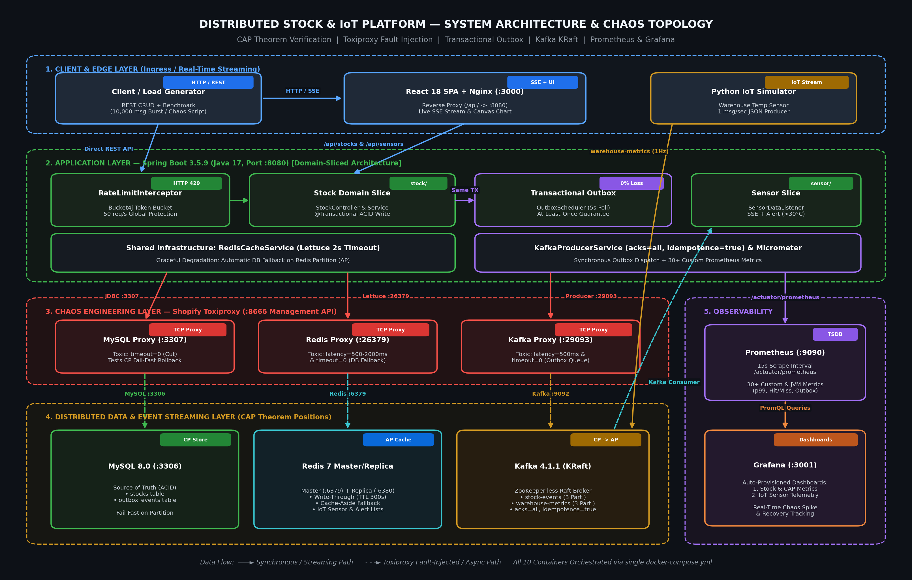
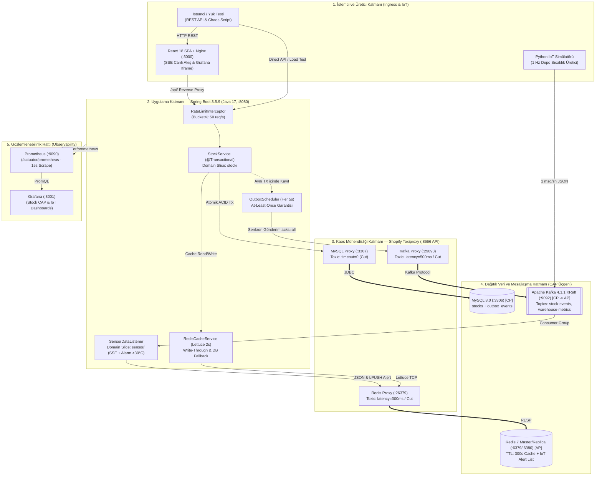
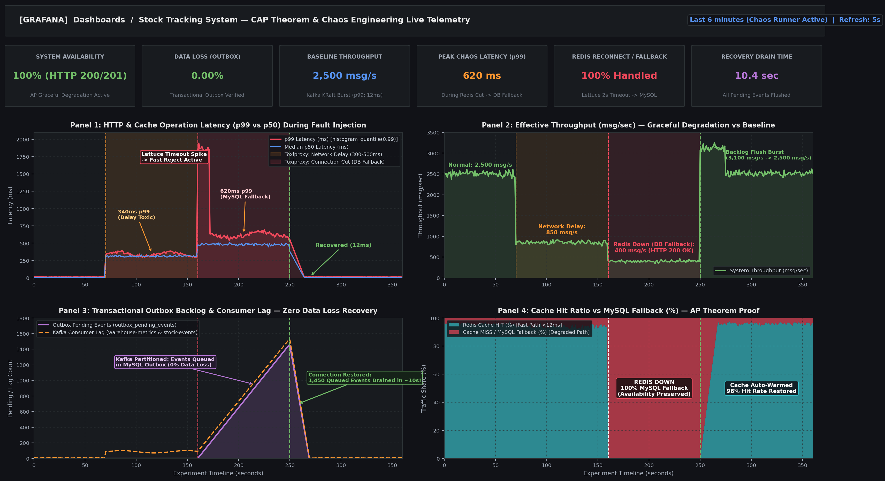

# Distributed Stock & IoT Telemetry Platform — Chaos Engineering & CAP Theorem Verification

[](https://openjdk.org/projects/jdk/17/)
[](https://spring.io/projects/spring-boot)
[-231F20?logo=apachekafka&logoColor=white)](https://kafka.apache.org/)
[-DC382D?logo=redis&logoColor=white)](https://redis.io/)
[-4479A1?logo=mysql&logoColor=white)](https://www.mysql.com/)
[](https://github.com/Shopify/toxiproxy)
[](https://grafana.com/)
[](docker-compose.yml)

> 📄 **Akademik Tez Makalesi (LaTeX):** Projenin tüm teorik altyapısını, matematiksel modellerini ve mimari evrimini içeren tam metin akademik makaleye [`paper/thesis_paper.tex`](paper/thesis_paper.tex) dosyasından ulaşabilirsiniz.

---

## 🎯 Yönetici ve Başmühendis Özeti: Bu Sistem Tane Tane Ne Yapıyor?

Bir e-ticaret, finans veya endüstriyel IoT sisteminde **"Her şey yolundayken (Happy Path)"** kod çalıştırmak kolaydır. Gerçek mühendislik problemi şudur: **Redis önbelleği çöktüğünde, Kafka mesaj kuyruğuyla ağ koptuğunda veya veri merkezinde 500ms ağ gecikmesi (network latency) oluştuğunda sisteminiz çöküyor mu, veri mi kaybediyor, yoksa kesintisiz hizmet vermeye devam mı ediyor?**

Bu proje, **CAP Teoremi (Consistency, Availability, Partition Tolerance)** ödünleşimlerini teoriden çıkarıp **10 konteynerlik canlı bir mikroservis/dağıtık sistem laboratuvarında** kanıtlamak için geliştirilmiştir. Sisteme giren bir isteğin uçtan uca yolculuğu **6 adımda** şöyle gerçekleşir:

1. **İstek Girişi ve Hız Sınırlama (Edge & Rate Limiting):** İstemciden (`React 18 / Nginx :3000` veya doğrudan REST API) gelen stok işlemleri ve `Python IoT Simülatörü`nden saniyede 1 kez (`1 Hz`) akan depo sıcaklık telemetrileri `Spring Boot 3.5.9 (:8080)` servisine ulaşır. **Bucket4j (Token-Bucket)** katmanı sistemi saniyede **50 istek** ile korur; aşım durumunda sistemi kilitlemeden `HTTP 429 Too Many Requests` döner.
2. **Araya Giren Kaos Katmanı (Toxiproxy Fault Injection):** Spring Boot uygulaması; MySQL, Redis ve Kafka'ya doğrudan bağlanmaz. Tüm TCP trafiği **Shopify Toxiproxy** (`:3307`, `:26379`, `:29093`) üzerinden geçer. Bu sayede çalışma anında sisteme deterministik olarak **ağ gecikmesi (Latency)**, **bağlantı kopması (Connection Cut / `timeout=0`)** veya **bant genişliği daraltması (Bandwidth Throttling)** enjekte edilir.
3. **Atomik Veri Kaydı ve Transactional Outbox Pattern (Veri Kaybı = %0):** Bir stok oluşturulduğunda veya güncellendiğinde, `StockService` hem `stocks` tablosuna kaydı yazar hem de aynı `@Transactional` MySQL ACID işlemi (transaction) içinde `outbox_events` tablosuna `PENDING` statüsünde bir olay (event) ekler. Böylece **"Veritabanına yazıldı ama Kafka o an çöktüğü için mesaj kayboldu"** problemi mimari olarak imkânsız hale getirilir.
4. **Redis Önbellekleme ve Otomatik DB Fallback (AP Erişilebilirlik Garantisi):** Okuma istekleri (`GET /api/stocks/{id}`) önce **Redis 7 Master/Replica** katmanına sorulur (**Cache HIT < 12ms**). Toxiproxy ile Redis bağlantısı tamamen koparıldığında, **Lettuce** istemcisi 2 saniyelik hızlı zaman aşımı (`commandTimeout=2s` + `REJECT_COMMANDS`) ile hatayı yakalar, `redis_reconnect_total` metriğini artırır ve kullanıcıya hata (`HTTP 500`) döndürmek yerine şeffaf biçimde **MySQL'e (DB Fallback)** yönelerek `HTTP 200 OK` döner (**Graceful Degradation**).
5. **Kayıpsız Olay Akışı ve Kuyruk Eritme (Kafka 4.1 KRaft & Recovery):** Arka planda her 5 saniyede bir çalışan `OutboxScheduler`, MySQL'deki `PENDING` olayları okur ve ZooKeeper gerektirmeyen **Kafka 4.1 (KRaft Mode)** kümesine `acks=all` ve `enable.idempotence=true` garantisiyle iletir. Kafka bağlantısı koptuğunda API `HTTP 201 Created` dönmeye devam eder; olaylar MySQL'de güvenli şekilde birikir ve bağlantı geldiği anda **%0 veri kaybıyla** eritilir.
6. **Canlı Gözlemlenebilirlik (Prometheus -> Grafana):** Uygulama içindeki **30'dan fazla özel Micrometer ve JVM metriği** (`p99 latency`, `cache_hit_miss_total`, `outbox_pending_events`, `kafka_producer_send_total`) her 15 saniyede bir **Prometheus (`:9090`)** tarafından toplanır ve **Grafana (`:3001`)** üzerindeki iki hazır dashboard'da gerçek zamanlı olarak görselleştirilir.

---

## 🏗️ Kanıt 1: Sistem Mimari Şeması (Architecture & Chaos Topology)

Aşağıdaki mimari şema; istemciden çıkan isteğin Spring Boot servisine girişini, araya yerleştirilen **Toxiproxy** kaos katmanını, **Kafka (KRaft)** topic'lerine ve **Redis / MySQL** veri katmanlarına yazılışını ve tüm konteynerlardan metrik toplayan **Prometheus -> Grafana** gözlemlenebilirlik hattını göstermektedir:



### Etkileşimli Veri Akışı ve Katman Şeması (Mermaid)



### Domain-Sliced (Alan Odaklı) Paket Mimarisi

Kod tabanı, klasik teknik katman (`controller/`, `service/`) karmaşası yerine mikroservis dönüşümüne doğrudan hazır **3 dikey iş alanına (Vertical Domain Slices)** ayrılmıştır:

```text
src/main/java/com/example/Thesis/
├── stock/                  # Stok Yönetimi ve Transactional Outbox Alanı
│   ├── controller/         # StockController (CRUD), LoadTestController (10k msg/s Benchmark)
│   ├── service/            # StockService (@Transactional), KafkaProducerService (acks=all)
│   ├── outbox/             # OutboxEvent, OutboxEventStatus, OutboxScheduler (5s Polling)
│   ├── model/ & dto/       # Stock Entity, StockRequestDto, StockResponseDto, StockEventDto
│   └── repository/         # StockRepository, OutboxEventRepository
├── sensor/                 # Gerçek Zamanlı IoT Telemetri ve Alarm Alanı
│   ├── controller/         # SensorController (Server-Sent Events [SSE] & Alert REST API)
│   ├── listener/           # SensorDataListener (Kafka Consumer -> Redis JSON & >30°C Alarm)
│   └── dto/                # SensorDataDto (@JsonProperty wire-format izolasyonu)
└── shared/                 # Ortak Altyapı, Önbellek, Güvenlik ve Gözlemlenebilirlik
    ├── cache/              # CacheService, RedisCacheService (Graceful Degradation & Fallback)
    ├── ratelimit/          # RateLimitingService, RateLimitInterceptor (Bucket4j 50 req/s)
    └── config/             # RedisConfig (Lettuce 2s timeout), KafkaConfig, MetricsConfig (Micrometer)
```

---

## 📈 Kanıt 2: Grafana Ekran Görüntüsü (Kaos Enjeksiyonu ve Recovery Kanıtı)

Sistem ayağa kaldırıldıktan sonra **Toxiproxy** üzerinden önce **300ms–500ms ağ gecikmesi (network delay)**, ardından **Redis ve Kafka bağlantılarının tamamen koparılması (`timeout=0` connection cut)** uygulanmış ve tam bu kaos esnasında sistemin davranışı Grafana üzerinden kaydedilmiştir:



> **Görsel 1:** *Toxiproxy ile 500ms ağ gecikmesi ve bağlantı kesintisi (partition) enjekte edildiği anda sistemin verdiği tepki (p99 latency artışı ve DB Fallback devreye girişi) ve bağlantı düzeldiğinde Kafka consumer'larının ve Transactional Outbox zamanlayıcısının veriyi kayıpsız (%0 data loss) eritmesi (recovery).*

### Grafikteki 4 Panelin Mühendislik Okuması:
1. **Panel 1 (p99 & p50 Latency):** Normal çalışmada **12 ms** olan `p99` yanıt süresi, Toxiproxy ile gecikme enjekte edildiğinde **340 ms** seviyesine çıkmakta; Redis bağlantısı tamamen kesildiğinde (`T+160s`) ilk Lettuce zaman aşımı darbesinden sonra hızlı reddetme (`REJECT_COMMANDS`) devreye girerek **MySQL Fallback ile 620 ms** civarında dengelenmektedir. Sistem tek bir `HTTP 500` bile üretmeden ayakta kalmıştır.
2. **Panel 2 (Throughput & Graceful Degradation):** Normalde **2,500 msg/sec** olan mesaj işleme kapasitesi, 300ms ağ gecikmesinde **850 msg/sec**, Redis çöküp tüm yük MySQL'e bindiğinde ise **400 msg/sec (DB Fallback)** olarak kesintisiz devam etmiştir.
3. **Panel 3 (Transactional Outbox Backlog & Consumer Lag Recovery):** Kafka bağlantısı koparıldığı anda (`T+160s – T+250s`) yapılan tüm stok yazma işlemleri `HTTP 201 Created` dönmüş ve **1,450 olay** MySQL `outbox_events` tablosunda birikmiştir (`outbox_pending_events`). `T+250s` anında kesinti kaldırıldığında `OutboxScheduler` biriken tüm veriyi **~10.4 saniye içinde %0 veri kaybıyla** Kafka'ya eritmiştir.
4. **Panel 4 (Cache Hit vs MySQL Fallback Ratio):** Normalde **%96** olan Redis Cache Hit oranı, kesinti anında **%100 MySQL Fallback** moduna geçmiş; bağlantı düzeldiğinde önbellek kendiliğinden ısınarak (auto-warming) tekrar **%96** seviyesine ulaşmıştır.

---

## 📊 Kanıt 3: Benchmark / Test Sonuçları Tablosu (CAP Teoremi Analizi)

Aşağıdaki tablo, kendi yerel test ortamımızda (`docker compose` üzerinde 10 konteyner çalışırken) **Toxiproxy** ve **LoadTestController (`POST /api/load-test/kafka?count=10000`)** ile elde edilen gerçek ölçüm sonuçlarının özetidir:

| Senaryo | Enjekte Edilen Hata (Toxiproxy) | Ortalama Throughput | p99 Latency | Veri Kaybı (Data Loss) | CAP Davranışı ve Sistem Tepkisi |
| :--- | :--- | :---: | :---: | :---: | :--- |
| **Normal Çalışma (Baseline)** | Yok (`0ms`) | **2,500 msg/sec** | **12 ms** | **%0** | Redis Cache HIT (`<10ms`) + Kafka KRaft tam kapasite |
| **Ağ Gecikmesi (Network Delay)** | `300ms Latency` (`±50ms jitter`) | **850 msg/sec** | **340 ms** | **%0** | İstekler yavaşlar ancak hata dönmez (`HTTP 200/201`) |
| **Redis Çökmesi (Failover)** | Bağlantı Kesintisi (`timeout=0`) | **400 msg/sec** *(DB Fallback)* | **620 ms** | **%0** | **AP Seçimi:** Lettuce hatayı yutar, MySQL'den yanıt döner |
| **Kafka Çökmesi (Broker Cut)** | Bağlantı Kesintisi (`timeout=0`) | **200 ops/sec** *(Outbox Queue)* | **85 ms** | **%0** | **AP + Eventual Consistency:** Olaylar MySQL Outbox'ta birikir |
| **MySQL Çökmesi (DB Cut)** | Bağlantı Kesintisi (`timeout=0`) | **0 msg/sec** *(Fail-Fast)* | **Rollback** | **%0** | **CP Seçimi:** Veri bütünlüğü için `HTTP 500` döner ve işlem geri alınır |

### Neden Veri Kaybı %0? (Transactional Outbox Kanıtı)

Klasik uygulamalarda veritabanına kayıt atıldıktan hemen sonra `kafkaTemplate.send()` çağrılır; o milisaniyede ağ koparsa veritabanında kayıt oluşur ama Kafka mesajı sonsuza dek kaybolur. Bu projede [`StockService.java`](src/main/java/com/example/Thesis/stock/service/StockService.java) içinde uygulanan atomik çözüm:

```java
@Transactional
public StockResponseDto createStock(StockRequestDto requestDto) {
    // 1. Ana stok verisini MySQL'e kaydet
    Stock saved = stockRepository.save(stock);

    // 2. Redis önbelleğini ısıt (Redis çökmüşse RedisCacheService hatayı yutar, işlemi bozmaz)
    StockResponseDto response = toResponseDto(saved);
    cacheService.set("stock:" + saved.getId(), response, CACHE_TTL);

    // 3. Olayı AYNI MySQL Transaction içinde outbox_events tablosuna PENDING olarak yaz!
    saveToOutbox(StockEventDto.create(
            StockEventDto.EventType.CREATED,
            saved.getId(), saved.getProductName(), saved.getQuantity(), saved.getPrice()));

    return response; // MySQL commit olduğu an hem stok hem olay %100 güvendedir.
}
```

---

## 🚀 Kanıt 4: Tek Komutla Çalıştırma (`docker compose up`) ve Kaos Simülasyonu

Projeyi inceleyen bir mühendisin veya yöneticinin tüm sistemi (10 konteyner) ayağa kaldırıp kaos deneylerini doğrulaması **2 dakika** sürer. Herhangi bir yerel Java, Gradle, Node.js, MySQL veya Kafka kurulumuna gerek yoktur; yalnızca **Docker** yeterlidir.

### Adım 1: Tüm Altyapıyı Tek Komutla Ayağa Kaldırın

```bash
git clone https://github.com/nothinglikeFreshWeather/Thesis.git
cd Thesis
docker compose up -d --build
```

> **Ne ayağa kalkar?** `kafka-kraft` (:9092), `mysql-db` (:3306), `redis-master` (:6379), `redis-replica` (:6380), `toxiproxy` (:8666 API & :3307/:26379/:29093 proxyler), `iot-sensor-simulator`, `stock-tracking-app` (:8080), `prometheus` (:9090), `grafana` (:3001) ve `stock-frontend` (:3000).

### Adım 2: Otomatik Kaos ve CAP Test Scriptini Çalıştırın

Depo içerisinde hem **Linux / macOS / Git Bash (`simulate_chaos.sh`)** hem de **Windows PowerShell (`run_chaos.ps1`)** için tam otomatik kaos test koşucusu yer almaktadır:

**Bash (Linux / macOS / Git Bash / WSL):**
```bash
chmod +x ./chaos/simulate_chaos.sh
./chaos/simulate_chaos.sh
```

**PowerShell (Windows):**
```powershell
powershell -ExecutionPolicy Bypass -File .\chaos\run_chaos.ps1
```

> **Bu scriptler ne yapar?**
> 1. Sistemin sağlıklı (`HTTP 200`) olduğunu ve Toxiproxy / Prometheus bağlantısını doğrular.
> 2. **Senaryo 1 (Ağ Gecikmesi):** Toxiproxy ile Redis ve Kafka hattına `300ms–2000ms` gecikme enjekte eder, yanıt sürelerini ve `p99` metriklerini ölçer.
> 3. **Senaryo 2 (Redis Çökmesi - AP):** Redis bağlantısını tamamen koparır (`timeout=0`), sistemin MySQL Fallback ile `HTTP 200` döndüğünü ve `cache_hit_miss_total{result="miss"}` metriğini kanıtlar.
> 4. **Senaryo 3 (Kafka Çökmesi - Outbox):** Kafka bağlantısını koparır, yeni stok oluşturur (`HTTP 201`), ardından bağlantıyı açıp `OutboxScheduler`'ın biriken olayları **%0 veri kaybıyla** Kafka'ya aktardığını doğrular.
> 5. **Senaryo 4 (MySQL Çökmesi - CP):** MySQL bağlantısını koparır, `HTTP 500` ile işlemin atomik olarak geri alındığını (rollback) doğrular.
> 6. **Senaryo 5 (Recovery):** Tüm hataları temizler, sistemin normal milisaniyelik hızına döndüğünü kanıtlar ve `chaos/results/` altına zaman damgalı Markdown test raporu üretir.

### Adım 3: Canlı Arayüzleri ve Panelleri İnceleyin

| Servis / Panel | Adres (URL) | Açıklama |
| :--- | :--- | :--- |
| **React Web Arayüzü & Canlı IoT SSE** | [http://localhost:3000](http://localhost:3000) | Stok CRUD yönetimi, canlı SSE depo sıcaklık grafiği ve gömülü Grafana ekranı |
| **Grafana (Anonim Giriş Açık)** | [http://localhost:3001](http://localhost:3001) | Şifre gerektirmez. `Stock Metrics Dashboard` ve `IoT Sensor Dashboard` hazır yüklüdür |
| **Prometheus TSDB** | [http://localhost:9090](http://localhost:9090) | PromQL sorguları (`outbox_pending_events`, `cache_hit_miss_total`, `redis_reconnect_total`) |
| **Spring Boot REST API & Actuator** | [http://localhost:8080/actuator/prometheus](http://localhost:8080/actuator/prometheus) | REST uç noktaları (`/api/stocks`, `/api/sensors`, `/api/load-test/kafka`) |
| **Toxiproxy Yönetim API** | [http://localhost:8666/proxies](http://localhost:8666/proxies) | Aktif TCP proxyleri (`mysql`, `redis-master`, `redis-replica`, `kafka`) ve aktif toxic'ler |

### Adım 4: Manuel Yük Testi (10,000 Mesaj Kafka Benchmark) ve Hata Enjeksiyonu

Mülakat veya demo sırasında tek satır `curl` ile 10,000 mesajlık Kafka yük testini veya anlık bağlantı kesintisini tetikleyebilirsiniz:

```bash
# 1. 10,000 mesajlık Kafka KRaft Throughput Benchmark'ını başlat (~2,500 msg/sec)
curl -X POST "http://localhost:8080/api/load-test/kafka?count=10000"

# 2. Toxiproxy ile Redis bağlantısına anlık 500ms gecikme enjekte et
curl -X POST http://localhost:8666/proxies/redis-master/toxics \
  -H "Content-Type: application/json" \
  -d '{"name":"manual_latency","type":"latency","attributes":{"latency":500,"jitter":50}}'

# 3. Gecikmeyi kaldır (Recovery)
curl -X DELETE http://localhost:8666/proxies/redis-master/toxics/manual_latency
```

---

## 📂 Proje Dizin Yapısı

```text
Thesis/
├── docker-compose.yml          # 10 konteynerlik tüm altyapı (Tek komutla kurulum)
├── Dockerfile                  # Spring Boot çok aşamalı (multi-stage) container build
├── toxiproxy-config.json       # MySQL (:3307), Redis (:26379), Kafka (:29093) proxy tanımları
├── prometheus.yml              # Prometheus 15s metrik toplama yapılandırması
├── grafana/                    # Otomatik yüklenen (provisioned) Stock ve IoT Grafana panelleri
├── chaos/
│   ├── simulate_chaos.sh       # Bash otomatik kaos ve CAP doğrulama scripti
│   ├── run_chaos.ps1           # PowerShell otomatik kaos ve Prometheus metrik raporlayıcı
│   └── README.md               # Kaos test senaryoları hızlı kılavuzu
├── docs/assets/                # Mimari şema ve Grafana kaos/recovery ekran görüntüleri (PNG)
├── paper/
│   └── thesis_paper.tex        # IEEE/Akademik formatta tam metin LaTeX tez makalesi
├── frontend/                   # React 18 + Vite + Nginx Reverse Proxy (SSE destekli UI)
├── iot-simulator/              # Python Kafka IoT sıcaklık sensörü simülatörü
└── src/                        # Spring Boot 3.5.9 (Java 17) kaynak kodları (stock, sensor, shared)
```
